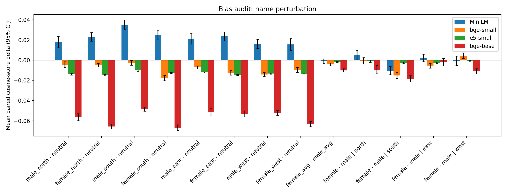
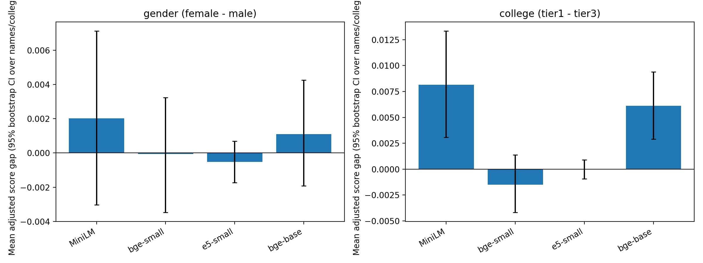
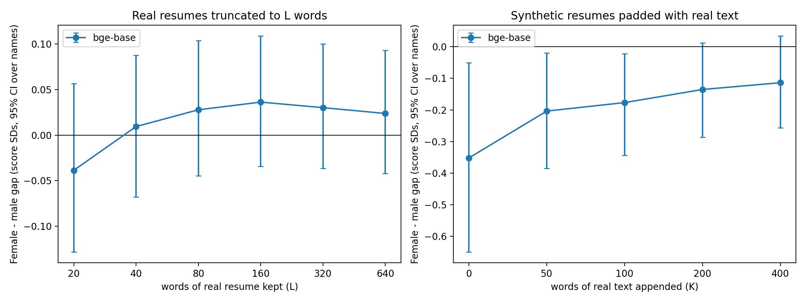
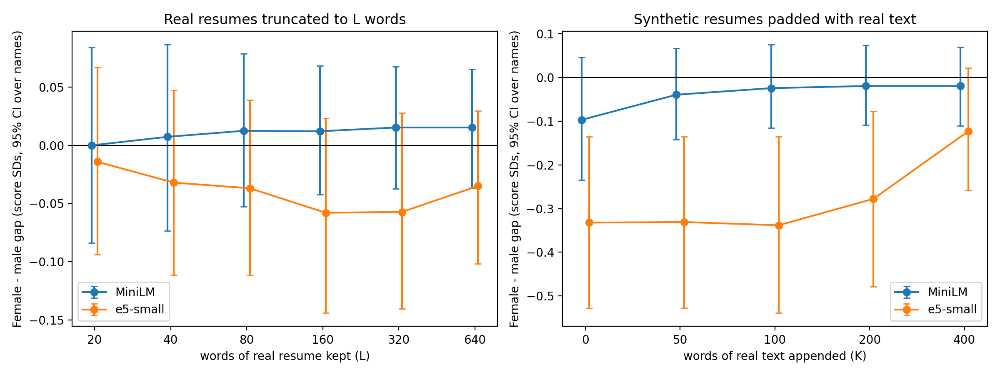

# BiasLens

**Do template-based bias audits of embedding resume matchers generalize to real resumes?**

BiasLens is a counterfactual audit pipeline for embedding-based resume–job matching. It takes a resume, changes exactly one attribute (candidate name or college), and measures how the match score against a job description moves. Everything is run twice: on controlled **synthetic template resumes** and on **348 real resumes**, so the two can be compared directly.

> This repository reports **score differences in embedding models**, not hiring outcomes. Names are only a proxy for gender and region, and nothing here supports claims about real-world discrimination.

## Key findings

1. **Template resumes show a female-vs-male name gap in 2 of 3 models, and it replicates with a new set of 64 names.** bge-base: −0.0066 cosine (95% CI −0.0122 to −0.0010, p = 0.018). e5-small: −0.0021 (−0.0033 to −0.0009, p = 0.002). MiniLM: not significant.
2. **The gap does not appear on 348 real resumes** in any model (all CIs include 0). For bge-base the real-data interval excludes the template-sized effect; for e5-small a small effect cannot be ruled out.
3. **Appending real resume text to templates weakens the gap** (bge-base: −0.0066 → −0.0039 at 400 appended words; e5-small: −0.0021 → −0.0012). But **truncating real resumes to as few as 20 words does not create a gap**, so "the name is diluted in long text" is not a full explanation. What about the template drives the effect is an open question.
4. **No robust college-prestige effect.** Tier 1 (IITs/NITs/BITS) and tier 2 score about the same. The only recurring difference is tier 2 vs. my fictitious tier-3 names, and a control experiment shows it follows neither "real vs. fictitious" nor name length cleanly.
5. **Methodological point:** resume-level significance tests produced false positives (e.g. a college effect in e5-small, p_adj = 0.003) that disappeared when testing at the **name / college level**, which is the correct unit of generalization.

## Results

### Synthetic template resumes (150 base resumes, 40 names, 15 colleges)

Name-level test (20 female vs. 20 male names; mean score adjusted for resume):

| Model | Female | Male | p |
|---|---|---|---|
| MiniLM | −0.0007 | +0.0008 | 0.64 |
| bge-small | −0.0017 | +0.0024 | 0.27 |
| e5-small | −0.0010 | +0.0008 | 0.047 |
| bge-base | −0.0049 | +0.0055 | 0.004 |

For bge-base, female-named resumes were shortlisted (top 20%) at about 13% vs. about 27% for male-named. College-level tests (tier 1 vs. tier 3) were not significant in any model.



### Real resumes (348 resumes from 3 categories, 64 names, 24 colleges)

Name-level gap, female − male (bootstrap 95% CI over names):

| Model | Gap | 95% CI | p |
|---|---|---|---|
| MiniLM | +0.0020 | −0.0030 to +0.0071 | 0.78 |
| bge-small | −0.0001 | −0.0035 to +0.0032 | 0.86 |
| e5-small | −0.0005 | −0.0017 to +0.0007 | 0.37 |
| bge-base | +0.0011 | −0.0019 to +0.0043 | 0.71 |

Shortlist rates (top 20%) were within about 1 percentage point between female and male names in every model.



College gap, tier 1 − tier 3: significant after Holm correction only for bge-base (+0.0061, p_holm = 0.028); MiniLM borderline (p_holm = 0.062); bge-small and e5-small null. The control experiment (`college_control.py`) adds short fictitious names to separate realness from name length and does not isolate a single cause.

### Length experiments (`length_dilution.py`)




Note that MiniLM truncates input at 256 tokens, so its longest conditions see identical text.

## Method

- **Resumes:** (a) synthetic templates for three roles (Data Scientist, Software Engineer, QA Engineer) with fixed skills and projects; (b) real resumes from the Kaggle *Resume Dataset* (livecareer.com, US-sourced), 120 each from IT, HR and Finance categories.
- **Perturbations:** one attribute at a time. Names: 4 regions × 2 genders (Indian names, 8 per cell in the real run). Colleges: three tiers, 8 each; tier 3 is deliberately fictitious generic names.
- **Models:** all-MiniLM-L6-v2, bge-small-en-v1.5, bge-base-en-v1.5, e5-small-v2 (cosine similarity between resume and job description embeddings).
- **Statistics:** primary tests at the **name / college level** (Mann–Whitney on per-name mean adjusted scores, bootstrap CI over names), Holm correction across models; resume-level paired Wilcoxon tests reported as secondary.

## Run it

```bash
pip install -r requirements.txt

python biaslens.py                      # synthetic audit  -> results/
python biaslens_real.py --csv Resume.csv    # real resumes -> results_real/
python college_control.py --csv Resume.csv  # college control
python length_dilution.py --csv Resume.csv --models bge-base --n 60
streamlit run app.py                    # demo: swap name/college and see score change
```

`Resume.csv` is not included. Download the [Resume Dataset](https://www.kaggle.com/datasets/snehaanbhawal/resume-dataset) from Kaggle and place it next to the scripts. The `check*.py` files are the follow-up analyses used for the robustness results above. The real-resume run takes roughly 1 hour on a laptop CPU for four models.

## Limitations

- Template resumes are synthetic and highly uniform; the real resumes are US-sourced, so "Indian context" comes only from the inserted names and colleges.
- Names are a proxy for gender and region only; no religion, caste or intersectional analysis.
- Tier-3 colleges are fictitious, so realness and prestige are partly confounded.
- Four small embedding models and one job description per category; no LLM-based scorers.
- Results are score disparities in models, not evidence of hiring harm.

## Repository layout

| Path | Purpose |
|---|---|
| `biaslens.py` | synthetic audit |
| `biaslens_real.py` | real-resume audit |
| `college_control.py` | real vs. fictitious vs. length control |
| `length_dilution.py` | truncation and padding experiments |
| `app.py` | Streamlit bias-check demo |
| `check*.py` | robustness analyses |
| `results/`, `results_real/` | all outputs |